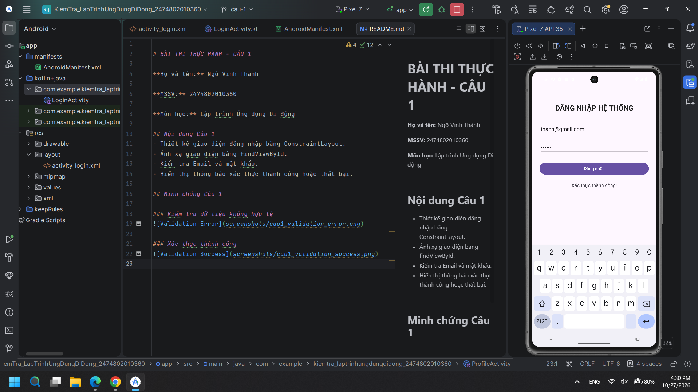

# BÀI THI THỰC HÀNH - CÂU 1

**Họ và tên:** Ngô Vinh Thành

**MSSV:** 2474802010360

**Môn học:** Lập trình Ứng dụng Di động

## Nội dung Câu 1
- Thiết kế giao diện đăng nhập bằng ConstraintLayout.
- Ánh xạ giao diện bằng findViewById.
- Kiểm tra Email và mật khẩu.
- Hiển thị thông báo xác thực thành công hoặc thất bại.

## Minh chứng Câu 1

### Kiểm tra dữ liệu không hợp lệ

### Xác thực thành công

## Minh chứng Câu 2

